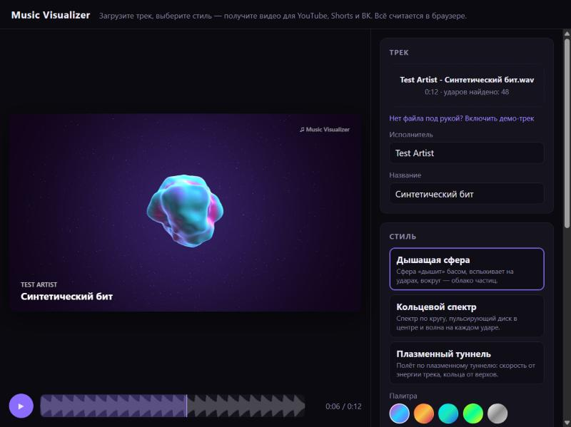
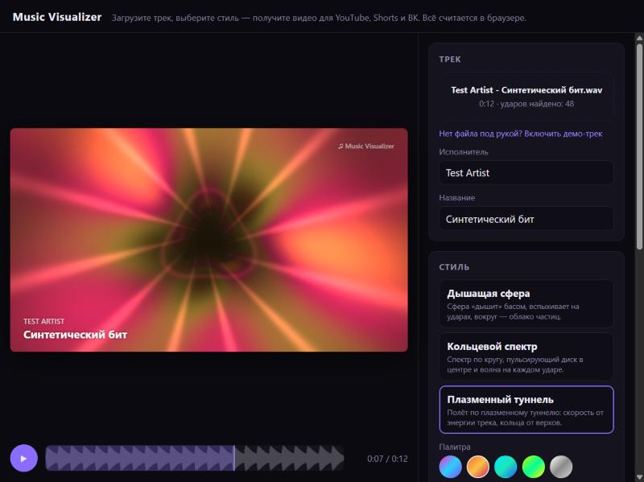
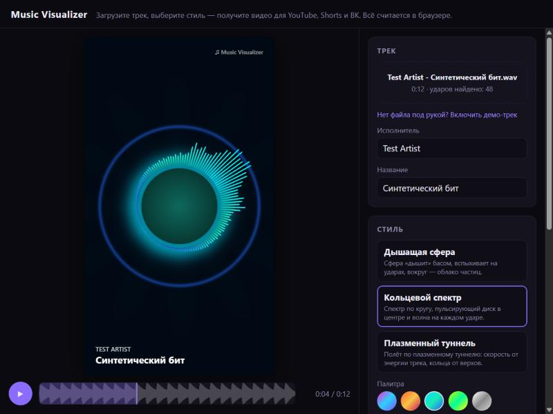

# Music Visualizer

Музыкант загружает трек, выбирает стиль визуализации и скачивает видео для YouTube, Shorts/Reels или клипов ВК. Видео процедурное: его рисуют шейдеры Three.js по анализу звука (громкость, бас/середина/верх, удары). Нейросети здесь нет. Всё считается в браузере, бэкенда нет.



| Плазменный туннель | Кольцевой спектр, 9:16 |
|---|---|
|  |  |

## Возможности

- Загрузка mp3, wav, ogg: перетаскиванием или кнопкой. Есть встроенный демо-трек, он синтезируется прямо в браузере.
- Офлайн-анализ всего трека заранее, 60 кадров анализа в секунду, в веб-воркере. Считается:
  - FFT;
  - энергия в полосах (бас 20–250 Гц, середина 250–4000 Гц, верх 4–16 кГц);
  - RMS;
  - детектор ударов (spectral flux с адаптивным порогом);
  - сглаживание огибающей (быстрая атака, плавный спад).
- Превью синхронизировано с `audioContext.currentTime`. Есть перемотка, а под шкалой видна «карта громкости» трека.
- Три стиля, у каждого 5–6 параметров (палитра, интенсивность, скорость и т. д.):
  - **Дышащая сфера.** 3D-сфера, которую деформирует шум в вершинном шейдере. Вокруг облако частиц, на ударах вспышки.
  - **Кольцевой спектр.** 128 столбиков через инстансинг, диск пульсирует от баса, на каждом ударе расходится волна.
  - **Плазменный туннель.** Полноэкранный фрагментный шейдер, скорость полёта зависит от энергии трека.
- Экспорт:
  - разрешения 1920×1080, 1080×1920, 1080×1080;
  - 30 или 60 FPS;
  - весь трек или фрагмент 15/30/60 с от текущей позиции;
  - прогресс-бар и отмена;
  - водяной знак, подпись «Исполнитель — Название».
- **MP4 через WebCodecs**: H.264 + AAC, мультиплексор [mediabunny](https://mediabunny.dev/). Кадры рисуются по номеру, а не по часам, поэтому экспорт идёт с той скоростью, какую дают видеокарта и кодировщик.
- **Запасной путь — MediaRecorder** (WebM в реальном времени). Включается сам, если WebCodecs недоступен; можно выбрать и вручную.

## Как запустить

Нужен Node.js 20+ (проверялось на 22.12).

```bash
npm install
```

```bash
npm run dev
```

Откройте адрес, который покажет Vite (обычно http://localhost:5173).

Остальные команды:

| Команда | Что делает |
|---|---|
| `npm test` | unit-тесты анализатора (vitest) |
| `npm run typecheck` | проверка типов TypeScript |
| `npm run build` | типы + production-сборка в `dist/` |
| `npm run lint` | линтер oxlint |
| `npm run gen:wav` | генерирует `test-assets/test-track.wav` (12 с, 120 BPM) для ручной проверки |

> Важно: WebCodecs работает только в **защищённом контексте** — на `https://` или `localhost`. Если открыть приложение по `http://192.168.…` с телефона, сработает только запасной экспорт.

## Путеводитель по коду

Читать лучше в таком порядке, от звука к картинке и к видео:

1. **`src/audio/analyzer.ts`** — главная идея проекта. Трек один раз раскладывается на массивы чисел по кадрам. Рядом лежит `analyzer.test.ts`: в нём видно, что ожидается на синусе, щелчках и тишине.
2. `src/audio/fft.ts` — быстрое преобразование Фурье. Короткое, с комментариями.
3. `src/audio/frameFeatures.ts` — как по времени `t` достать признаки кадра (`bass`, `beatPulse`, `spectrum` …).
4. **`src/styles/types.ts`** — контракт стиля. Затем любой стиль, проще всего начать с `plasmaTunnel.ts`: там один шейдер на весь экран.
5. `src/render/Visualizer.ts` — обёртка над `WebGLRenderer`: стиль + текстовый оверлей (`textOverlay.ts`).
6. `src/components/PreviewCanvas.tsx` — цикл `requestAnimationFrame` для превью. `src/audio/AudioPlayer.ts` — проигрывание и часы.
7. **`src/export/exportMp4.ts`** — экспорт: рендер кадра → `CanvasSource` → `VideoEncoder` → MP4. Запасной путь лежит в `exportRealtime.ts`.
8. `src/App.tsx` — склеивает всё вместе: состояние и обработчики.

```
src/
  audio/       анализ, плеер, загрузка, демо-трек, воркер
  render/      Visualizer, текстовый оверлей, палитры, общие куски GLSL
  styles/      стили визуализации + реестр (index.ts)
  export/      экспорт MP4 и WebM, разрешения
  components/  React-компоненты интерфейса
scripts/       генерация тестового WAV
```

### Почему превью и видео совпадают

Анализ детерминированный и делается заранее. Стиль получает только `features` (что звучит в момент `t`) и `params`. Время между кадрами он не знает. Всё «движение» выводится из `t` и из `features.energy`, а это накопленная громкость, монотонная функция времени. Поэтому кадр №1234 одинаков в превью и в экспорте, перемотка ничего не ломает, а экспорт может идти быстрее реального времени.

## Как добавить новый стиль

1. Создайте `src/styles/myStyle.ts` по образцу `plasmaTunnel.ts`:

   ```ts
   import * as THREE from 'three'
   import { FULLSCREEN_VERTEX, PALETTE_GLSL } from '../render/glsl.ts'
   import { applyPalette, paletteUniforms } from '../render/palettes.ts'
   import { numberParam, stringParam, type StyleDefinition, type StyleInstance } from './types.ts'

   const fragment = /* glsl */ `
     ${PALETTE_GLSL}
     uniform float uBass;
     uniform float uBeat;
     varying vec2 vUv;
     void main() {
       float d = length(vUv - 0.5);
       float ring = smoothstep(0.02, 0.0, abs(d - 0.2 - 0.15 * uBass));
       gl_FragColor = vec4(paletteColor(d) * ring + uBeat * 0.2, 1.0);
     }
   `

   function createInstance(): StyleInstance {
     const scene = new THREE.Scene()
     const camera = new THREE.OrthographicCamera(-1, 1, 1, -1, 0, 1)
     const uniforms = { ...paletteUniforms(), uBass: { value: 0 }, uBeat: { value: 0 } }
     const quad = new THREE.Mesh(
       new THREE.PlaneGeometry(2, 2),
       new THREE.ShaderMaterial({ uniforms, vertexShader: FULLSCREEN_VERTEX, fragmentShader: fragment }),
     )
     quad.frustumCulled = false
     scene.add(quad)

     return {
       scene,
       camera,
       update(features, params) {
         applyPalette(uniforms, stringParam(params, 'palette', 'neon'))
         uniforms.uBass.value = features.bass * numberParam(params, 'intensity', 1)
         uniforms.uBeat.value = features.beatPulse
       },
       resize() {},
       dispose() {
         quad.geometry.dispose()
         quad.material.dispose()
       },
     }
   }

   export const myStyle: StyleDefinition = {
     id: 'my-style',
     name: 'Мой стиль',
     description: 'Кольцо, которое растёт от баса.',
     params: [
       { type: 'palette', key: 'palette', label: 'Палитра', default: 'neon' },
       { type: 'number', key: 'intensity', label: 'Интенсивность', min: 0, max: 2, step: 0.05, default: 1 },
     ],
     create: createInstance,
   }
   ```

2. Добавьте его в массив `STYLES` в `src/styles/index.ts`. Интерфейс сам построит карточку и слайдеры по списку `params`.

Правила, которые стоит соблюдать:

- **`update()` не должен зависеть от того, сколько времени прошло с прошлого вызова.** Никаких `rotation += 0.01`. Вместо этого `rotation = features.time * k` или `features.energy * k`. Иначе превью и экспорт разойдутся.
- Всё, что создано в `create()`, освобождается в `dispose()`: геометрии, материалы, текстуры.
- Размеры в `resize()` учитывайте для любых пропорций. Проверьте 9:16: в вертикальном кадре сцена должна влезать по ширине.
- Случайность — только детерминированная, с фиксированным зерном (см. `seededRandom` в `pulseSphere.ts`).
- При `npm run dev` правки в файле стиля подхватываются на лету (HMR).

Что доступно в `features` (всё в 0..1, кроме `time` и `energy`):

| Поле | Смысл |
|---|---|
| `time` | секунды от начала трека |
| `bass`, `mid`, `treble` | сглаженная энергия в полосах |
| `rms` | сглаженная общая громкость |
| `beatPulse` | 1 в момент удара, затем затухает примерно за 0,35 с |
| `energy` | накопленная громкость, растёт со временем; удобна как «фаза» движения |
| `spectrum` | `Float32Array` из 64 столбиков по логарифмической шкале (30 Гц – 16 кГц) |

## Поддержка браузеров

Данные [caniuse.com/webcodecs](https://caniuse.com/webcodecs), проверено 28.10.2026:

| Браузер | WebCodecs (`VideoEncoder`/`AudioEncoder`) |
|---|---|
| Chrome / Edge (десктоп) | с версии 94 |
| Chrome для Android | поддерживается |
| Firefox (десктоп) | с версии 130 |
| Firefox для Android | не поддерживается |
| Safari (macOS и iOS) | 16.4–18.x — частично, полностью — с 26.0 |
| Opera / Samsung Internet | поддерживается (Opera 80+, Samsung 17+) |

На что обратить внимание:

- Работает только в secure context (HTTPS или localhost). Это указано на MDN для `VideoEncoder` и `AudioEncoder`.
- Даже если WebCodecs есть, конкретного кодека может не быть. Например, документация mediabunny пишет, что «в некоторых браузерах» WebCodecs не умеет кодировать AAC (каких именно, не уточняется). Поэтому приложение не надеется на конкретный кодек: перед экспортом оно спрашивает браузер через `getFirstEncodableVideoCodec` / `getFirstEncodableAudioCodec`. Видео — H.264 → HEVC → VP9 → AV1, звук — AAC → Opus. Если ничего не подошло, включается MediaRecorder.
- Пока что проверено в браузерной панели на базе Chromium: экспорт MP4 (H.264 + AAC) и WebM (VP9 + Opus). Firefox и Safari вживую не проверялись 🔎.
- WebM от MediaRecorder в Chromium получается без длительности в заголовке: у `<video>` `duration` выходит `Infinity`. Плееры и YouTube такой файл обычно принимают 🔎, но это одна из причин держать MediaRecorder только запасным вариантом.
- Скорость экспорта зависит от железа и сильно гуляет. В тестовом окружении (панель браузера, часто скрытая):
  - 7,4 с ролика 1080×1920 при 30 FPS — за 9,1 с;
  - 12 с ролика 1920×1080 при 60 FPS — за 41,7 с;
  - в другом прогоне того же ролика за 2 с набралось 28 %.

  По замерам почти всё время уходит на `videoSource.add()`, то есть кодирование и чтение кадра с GPU. Рендер сцены — около 1 %. Во время экспорта вкладку лучше держать видимой.
- `AudioContext.outputLatency` (компенсация задержки звука в превью) по MDN — «Baseline 2025». Где его нет, задержка считается нулевой.

## Проверка, которая проводилась

- `npm test`: 15 тестов анализатора проходят.
  - 60 Гц → бас, 5 кГц → верх, 1 кГц → середина;
  - RMS синуса = A/√2;
  - щелчки раз в 0,5 с находятся детектором (при 60 и 30 FPS), на ровном синусе ударов нет;
  - тишина даёт нули;
  - детерминированность;
  - удары бочки в демо-треке.
- `npm run typecheck`, `npm run build`, `npm run lint`: без ошибок.
- В браузере:
  - сгенерированный `test-track.wav` загружен через `<input type=file>`, найдено 48 ударов (бочка + хэт);
  - проверены превью всех трёх стилей, 16:9 и 9:16, перемотка;
  - экспорт MP4 1080×1920 30 FPS: файл 5,5 МБ (`ftyp isom`, `avc1` + `mp4a`, `moov` в начале), кадры не пустые;
  - экспорт MP4 1920×1080 60 FPS на весь трек: 15 МБ, длительность 12,01 с;
  - экспорт WebM 1080×1080 через MediaRecorder;
  - отмена экспорта.

## Стек

React 19 + TypeScript + Vite 8, Three.js 0.186 (свои GLSL-шейдеры), Web Audio API, WebCodecs + [mediabunny](https://github.com/Vanilagy/mediabunny) 1.62, vitest. Библиотека `mp4-muxer` в npm помечена как устаревшая («superseded by Mediabunny»), поэтому выбрана mediabunny.
