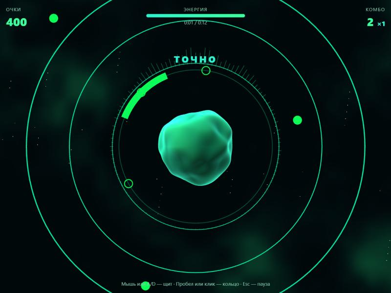

# Орбита: ритм-игра из своего трека

Прототип, чтобы проверить одну вещь: затягивает ли игра. Запуск: `npm run dev`, затем откройте `/game.html`. Vite покажет порт, обычно это http://localhost:5173/game.html.

## Как играть

В центре ядро, оно сжимается на ударах. Вокруг орбита, по ней ходит щит.

| Нота | Что делать | Управление |
|---|---|---|
| Круглая искра | поймать щитом | мышь, палец, A/D или стрелки |
| Кольцо (сильная басовая доля) | нажать в момент касания орбиты | пробел, клик или тап |
| Треугольный осколок | не задеть щитом | увести щит |

- Комбо поднимает множитель очков до ×4.
- Промахи и осколки отнимают энергию. На средней и сложной сложности без энергии партия заканчивается, на лёгкой проиграть нельзя.
- В меню настраиваются сложность, скорость нот, громкость и поправка на задержку звука. Есть автопилот.

## Что проверено на рынке

Проверка от 31.10.2026 по открытым страницам, продажи я не нашёл.

- **Спрос есть.** У [Beat Hazard](https://store.steampowered.com/app/49600/Beat_Hazard) 95 % положительных из 5 009 отзывов, игра дошла до третьей части. У Audiosurf 2 указывают 83 % положительных из 6 017 отзывов, это данные стороннего сайта [Nodal](https://nodal.gg/game/audiosurf-12900).
- **Сама загрузка своего трека отличием не будет.** Так уже умеют [Soundodger](https://fungies.io/indie-directory/soundodger/), [Pitch Jumper](https://www.pocketgamer.com/pitch-jumper/pitch-jumper-is-a-musical-platformer-that-uses-your-music-to-create-levels) и много небольших игр на itch.io, например [BeatRush](https://fialagames.itch.io/beatrush) и [ByteBeat](https://magnaccioni.itch.io/bytebeat). В браузере есть [Pulse 2026](https://honlex.itch.io/pulse-26).
- **Значит, отличаться надо игрой.** Своей механикой, оформлением и удобством: открыл ссылку и играешь, ничего не устанавливая.
- 🔎 Покупают ли такое в браузере и сколько готовы платить, неизвестно. Эта проверка даёт ответ только на вопрос, интересен ли жанр.

## Как устроен код

1. `src/game/level.ts` строит уровень из анализа трека. Одинаковый трек всегда даёт одинаковый уровень, поэтому рекорды можно сравнивать.
2. `src/game/gameState.ts` — правила: попадания, очки, энергия. Здесь только числа, без графики, поэтому всё покрыто тестами в `game.test.ts`.
3. `src/game/GameScene.ts` — графика на Three.js и шейдеры.
4. `src/game/GameApp.tsx` — меню, управление и игровой цикл. Время берётся из звуковых часов (`audioContext.currentTime`), поэтому ноты привязаны к музыке, а не к частоте кадров.

Анализатор и плеер общие с визуализатором (`src/audio`).

## Что проверено, а что нет

- 13 новых тестов: уровень детерминирован, щит всегда успевает до следующей искры, кольца попадают на доли бочки, в тишине нот нет, правила очков и энергии, автопилот не промахивается.
- В браузере: загрузка WAV через файловый ввод, меню, партия и экран результатов. Автопилот на сложной сложности прошёл тестовый трек на 100 %, ошибок в консоли нет.
- **Живая игра руками не проверялась.** Панель браузера была скрыта и рисовала один кадр в секунду. Ощущение от управления и точность попадания в такт может оценить только человек.
- На настоящей музыке уровни не проверялись: только на синтетическом треке с чёткими ударами. На сложной музыке детектор может ошибаться чаще.
- Управление на телефоне написано, но не проверялось.

## Если затянет, что дальше

- Настроить ощущение от игры на настоящих треках: окна нажатия, частоту нот.
- Мастер калибровки задержки вместо ползунка.
- Уровень по ссылке: другу уходит только зерно и характеристики трека, сам файл не передаётся.
- Режимы: больше орбит, несколько щитов, смена механики на припеве.
