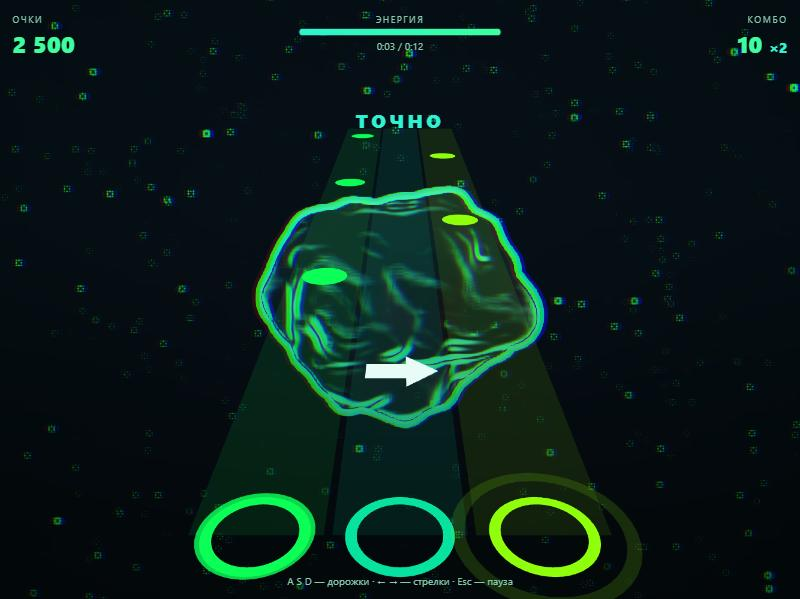

# Триада: три дорожки поверх вашего клипа

Ритм-игра для ПК в жанре «ноты спускаются по дорожкам». Вдохновлена ощущением от мобильных игр с тремя дорожками, но название, оформление, управление и уровни свои. Уровень строится из вашего файла, встроенных песен нет.

Запуск: `npm run dev`, затем откройте `/lanes.html`. Vite покажет порт, обычно это http://localhost:5173/lanes.html.

## Как играть

| На экране | Что делать |
|---|---|
| Круг на дорожке | нажать A, S или D, когда он дошёл до кольца (или 1, 2, 3) |
| Белая стрелка | нажать ← или → в ту же сторону |
| Надпись «ВСТРЯСКА» | трясти мышь влево-вправо или часто жать пробел, за заполненную шкалу бонус |

Esc — пауза. Встряски появляются только в треках от 30 секунд, на самых громких трёх секундах.

## Клип на фоне

Это главное отличие игры. Загрузите mp4 или webm целиком, и звук с картинкой возьмутся из него. Можно загрузить песню и отдельное видео.

- Клип занимает весь экран и обрезается без искажений.
- Четыре обработки: неоновый контур, зелёный дуотон, комикс, оригинал. Есть ползунок яркости.
- На басу кадр слегка наезжает, на ударе расходятся цветовые каналы. Вспышек нет.

Клип с YouTube напрямую подключить нельзя: браузер не даёт шейдеру читать кадры чужого плеера 🔎. Поэтому нужен свой файл. Файлы никуда не загружаются. Выкладывать в открытый доступ игру с чужими песнями и клипами нельзя без прав, поэтому модель «пользователь приносит свой файл» здесь основная.

## Как проверить на Stargazing

Файла трека на компьютере не нашлось, а скачивать его я не стал. Поэтому:

1. Загрузите свой файл песни или клипа в меню.
2. Обратите внимание на смену бита посреди песни: уровень должен поменять плотность нот. На синтетическом треке это покрыто тестом, на самой песне нет.
3. В таком треке есть голос и эффекты, детектор ударов может отвечать на них. Если нот слишком много, возьмите сложность ниже. Если ноты не попадают в бочку, напишите, на какой секунде.

## Как устроен код

1. `src/lanes/level.ts` строит уровень. Дорожка зависит от высоты звука: низкие удары слева, высокие справа.
2. `src/lanes/rules.ts` — правила без графики. Тесты в `lanes.test.ts`.
3. `src/lanes/LaneScene.ts` — графика и шейдер клипа.
4. `src/lanes/LanesApp.tsx` — меню, клавиши и игровой цикл. Время берётся из звука, видео подтягивается к нему, если разошлось больше чем на 0,15 с.

## Что проверено, а что нет

- 12 новых тестов, включая смену темпа посреди трека.
- В браузере: MP4 с картинкой и звуком загружен одним файлом, автопилот на сложной сложности прошёл его на 100 %, видео закончилось вместе со звуком, ошибок в консоли нет.
- **Не проверено руками:** панель браузера была скрыта и рисовала редкие кадры, поэтому ощущение от клавиш и точность попадания оценить не удалось.
- **Не проверено на настоящей музыке.** Только синтетические треки.
- Тряска мышью и бонус написаны и покрыты тестом правил, но сама мышь в браузере не проверялась. Обработки «дуотон» и «комикс» на экране не проверялись.
